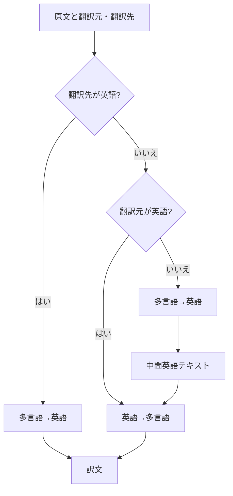
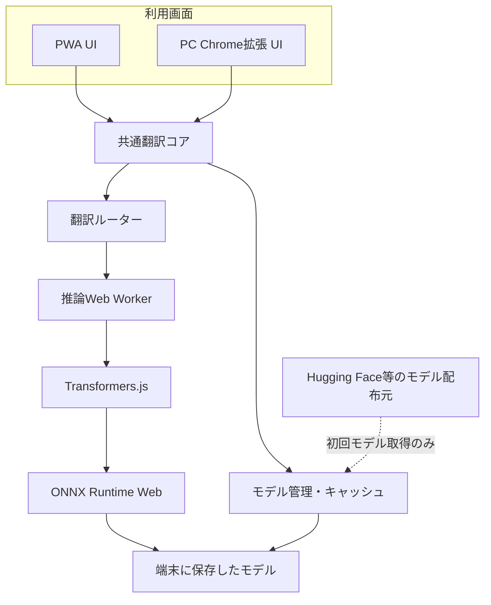

# Local Translator — 技術設計書

| 項目 | 内容 |
|---|---|
| 文書ID | LT-TDD-001 |
| 版 | 1.0（技術検証前ドラフト） |
| 作成日 | 2026-11-18 |
| 関連仕様 | `01_product_requirements.md` |
| 適用範囲 | スマホPWA、共通翻訳コア、PC Chrome拡張機能 |

## 1. 技術選定の結論

**採用案：TypeScript + Vite + PWA + Transformers.js + ONNX Runtime Web + OPUS-MT（2モデル）。**

- スマホ用はPWAとする。iPhone Safari/Chrome、Android Chrome、PCブラウザから利用する。
- PC向けChrome拡張機能はManifest V3で別パッケージとして作る。
- 推論はブラウザのWeb Worker内で実行する。バックエンドの翻訳サーバーは作らない。
- 初期実装ではCPU/WASMで確実に動く道を優先し、WebGPUは性能評価後のオプションとする。
- 大容量モデルをアプリ本体に同梱せず、必要になった時点で端末へダウンロードする。
- 文章はクラウドへ送信しない。モデル資産の初回取得とアプリ更新の通信は例外とする。

### 1.1 前提の訂正

前の回答で挙げた `WhirlwindAI/Translate-25T` はHugging Faceのモデル一覧で **0.6B** と表示されている。**0.4B以下という制約に反するため不採用**。公式モデルカード内の例示コードには別リポジトリ名が混在しており、この点でもそのまま実装依存にしない。

## 2. モデル設計

### 2.1 モデル一覧

| 論理名 | モデルID（ブラウザ版） | 役割 | 元モデル |
|---|---|---|---|
| `toEnglish` | `Xenova/opus-mt-mul-en` | 日本語またはロシア語 → 英語 | `Helsinki-NLP/opus-mt-mul-en` |
| `fromEnglish` | `Xenova/opus-mt-en-mul` | 英語 → 日本語またはロシア語 | `Helsinki-NLP/opus-mt-en-mul` |

両元モデルはApache-2.0として公開されている。JavaScript/ONNX対応版が公開済みであるため、ゼロからONNX変換する必要がない可能性が高い。**実際の量子化モデルの起動可否・tokenizerの整合性はP0で検証する**。

各元モデルのPyTorchモデル重みファイルは約310MB（FP32想定）である。単純にfloat32を4バイト/値として概算すれば約7,750万値/モデルとなり、各0.4B未満と推定できる。ただし、これは重みサイズからの概算であり、**パラメータ数の正式な確認にはチェックポイントを読み取って `sum(p.numel())` を計測する**。2モデルを同時使用したときのRAMやモデル総量の計測とは別問題である。

### 2.2 言語指定とルーティング

対応する言語コードは `ja`、`en`、`ru` とする。英語→多言語モデルは文頭に宛先を示す特殊トークンが必要である。元モデル資料に従い以下を候補とする。

- 英語→日本語：`>>jpn<< ` + 原文
- 英語→ロシア語：`>>rus<< ` + 原文
- 日本語/ロシア語→英語：`toEnglish` に原文を入力（対象の原文コードをUI側で記録）

**注意：** これらのプレフィックスを対象ONNXトークナイザが期待どおり認識するか、実機で検証する。`ja`/`ru` など2文字コードを機械的に埋め込まない。



| 元 | 先 | モデル順序 | 先頭トークン |
|---|---|---|---|
| ja | en | `toEnglish` | なし |
| ru | en | `toEnglish` | なし |
| en | ja | `fromEnglish` | `>>jpn<<` |
| en | ru | `fromEnglish` | `>>rus<<` |
| ja | ru | `toEnglish`→`fromEnglish` | 2段目に`>>rus<<` |
| ru | ja | `toEnglish`→`fromEnglish` | 2段目に`>>jpn<<` |

### 2.3 重み形式・モデル容量

配布されているXenovaモデルは複数のONNX形式を含む。モデルリポジトリ全体を取得してはならない。**選択した実行時形式で必要なencoder/decoder・tokenizerファイルのみを取得する。**

公開ファイル一覧では、各モデルに量子化済みの `encoder_model_quantized.onnx`（約52MB）と `decoder_model_merged_quantized.onnx`（約60MB）がある。両モデルのONNX重みは、選択できれば概算 **約224MB（約112MB×2）+ tokenizer・ランタイム等** である。ただし、実際の `dtype: 'q8'` によるファイル解決、互換性、重複資産、ダウンロード量はパッケージ版と環境で検証し、アプリ内では実測値を表示する。

初回はq8相当を優先し、q4は品質劣化とロード互換性を評価してから追加する。量子化でパラメータ数は減らないことに注意する。

## 3. システム構成



原文・訳文がネットワーク側に流れない設計とする。PWA静的ファイルのホスティングは可能だが、翻訳APIサーバーは置かない。

### 3.1 技術スタック

| レイヤー | 技術 | 用途 |
|---|---|---|
| 言語 | TypeScript | フロント、コア、Workerを共通化 |
| UI | React + Vite（仮採用） | PWA画面と拡張画面 |
| PWA | Service Worker + Web App Manifest | アプリシェルと再訪時の利用 |
| 推論 | `@huggingface/transformers` | 翻訳パイプラインとトークナイザ |
| 実行系 | ONNX Runtime Web（Transformers.js依存） | WASM/必要に応じWebGPU |
| 並列実行 | Web Worker | メインスレッド非ブロック |
| ローカル保存 | Cache Storage / IndexedDB | モデル・メタデータ・設定 |
| 拡張機能 | Chrome Manifest V3 | PCブラウザ入力欄への連携 |
| テスト | Vitest, Playwright, 実機手動テスト | 単体/結合/E2E/性能 |
| 配信 | 静的ホスティング | 画面と静的ファイルのみ配信 |

依存ライブラリのバージョンは `package-lock.json` などで固定し、実装時に動作を確認した組み合わせを採用する。上流のlatest版への無条件更新は行わない。

## 4. ディレクトリ構成案

```text
local-translator/
├── apps/
│   ├── web/                       # PWA
│   │   ├── public/manifest.webmanifest
│   │   ├── public/sw.js
│   │   └── src/
│   └── extension/                 # Desktop Chrome Manifest V3
│       ├── public/manifest.json
│       └── src/
├── packages/
│   ├── translator-core/
│   │   └── src/
│   │       ├── languages.ts
│   │       ├── routing.ts
│   │       ├── translator.ts
│   │       └── segmentation.ts
│   ├── inference-worker/
│   │   └── src/worker.ts
│   ├── model-manager/
│   │   └── src/
│   │       ├── manifest.ts
│   │       ├── cache.ts
│   │       └── storage.ts
│   └── ui/
├── tests/
│   ├── translations/
│   ├── offline/
│   └── privacy/
├── docs/
│   ├── product-requirements.md
│   └── technical-design.md
├── package.json
└── README.md
```

UIやエディタ連携はプラットフォームごとに異なるが、`translator-core`、推論Worker、モデル定義を共有する。Service WorkerとWeb Workerを混同しない。

## 5. 型・インターフェース設計

```ts
export type Lang = 'ja' | 'en' | 'ru';
export type ModelKey = 'toEnglish' | 'fromEnglish';

export interface TranslateRequest {
  requestId: string;
  source: Lang;
  target: Lang;
  text: string;
}

export interface TranslateResult {
  requestId: string;
  source: Lang;
  target: Lang;
  output: string;
  intermediateEnglish?: string;
  steps: 1 | 2;
  elapsedMs: number;
}

export type WorkerRequest =
  | { type: 'LOAD_MODEL'; requestId: string; model: ModelKey }
  | { type: 'TRANSLATE'; request: TranslateRequest }
  | { type: 'RELEASE_MODEL'; model: ModelKey }
  | { type: 'CANCEL'; requestId: string };

export type WorkerResponse =
  | { type: 'PROGRESS'; requestId: string; phase: 'download' | 'load' | 'infer'; loaded?: number; total?: number }
  | { type: 'RESULT'; result: TranslateResult }
  | { type: 'ERROR'; requestId: string; code: string; message: string };
```

注意：JavaScriptのPromiseによるキャンセルだけでは、すでに実行中のONNX演算を即時中断できない可能性がある。キャンセル時は古い `requestId` の結果を破棄し、必要であればWorkerを再生成する。

### 5.1 ルーティングの純粋関数

```ts
export function getRoute(source: Lang, target: Lang): ModelKey[] {
  if (source === target) throw new Error('same-language');
  if (target === 'en') return ['toEnglish'];
  if (source === 'en') return ['fromEnglish'];
  return ['toEnglish', 'fromEnglish'];
}

export function withTargetToken(target: Lang, text: string): string {
  if (target === 'ja') return `>>jpn<< ${text}`;
  if (target === 'ru') return `>>rus<< ${text}`;
  throw new Error('Unsupported target for fromEnglish model');
}
```

### 5.2 推論初期化の概念コード

以下は実装の方向性を示す**概念コード**であり、利用バージョン・モデルの量子化ファイルと引数をP0で動作検証すること。

```ts
import { pipeline } from '@huggingface/transformers';

const toEnglish = await pipeline('translation', 'Xenova/opus-mt-mul-en', {
  device: 'wasm',
  dtype: 'q8',
});

const fromEnglish = await pipeline('translation', 'Xenova/opus-mt-en-mul', {
  device: 'wasm',
  dtype: 'q8',
});

const en = await toEnglish('こんにちは。');
const ru = await fromEnglish('>>rus<< Hello.');
// 実際の出力構造、トークンの解釈、量子化ロード可否を検証する。
```

実製品では1回の翻訳方向に必要なモデルだけを初期化し、Worker内でキャッシュする。2段階翻訳では、メモリ不足端末に限り1段目モデルを解放してから2段目をロードする。

## 6. 翻訳処理のシーケンス

1. UIで原文、翻訳元、翻訳先を入力する。
2. バリデーションを通過したら一意の `requestId` を採番する。
3. 翻訳ルートを決定し、必要モデルの所在をモデル管理モジュールに問い合わせる。
4. 未取得の場合は事前にモデル容量・ネット接続を案内し、了承後に取得する。
5. モデルファイルのハッシュとmanifestを検証し、読み込みを開始する。
6. 入力長をトークナイザで評価し、必要であれば段落・文単位に分割する。
7. Web Workerへ推論を指示する。翻訳中は処理段数と進捗をUIに送る。
8. 日本語⇄ロシア語の場合は1段目英語結果を2段目の入力にする。
9. 分割結果を元の順序へ連結する。失敗があれば全体を成功扱いしない。
10. 成功した訳文を表示する。原文は残し、訳文だけ任意でコピーできる。

### 6.1 長文分割

- 文字数での単純切断は語・句を壊しやすいため、段落→句点・疑問符等の文境界を優先する。
- モデルの入力長上限と特殊トークン分を差し引き、実トークン数で上限を判定する。
- 同一文章内の複数チャンクは原則順次処理する。スマホで並列にモデルを複製しない。
- 日露・露日では、1段目の各チャンクを英訳し、各チャンクの英訳を2段目へ送る。中間英語の長さが増える場合は再分割する。
- 改行を可能な限り維持する。ただし生成翻訳で句読点やレイアウトが完全保存される保証はない。

## 7. オフライン対応・モデル配布

### 7.1 2種類のキャッシュ

1. **アプリシェル**：Service WorkerでHTML/JS/CSS/アイコン等をキャッシュする。
2. **モデル資産**：Transformers.jsのキャッシュ機能とブラウザのStorage APIを使ってONNX重み、設定ファイル、tokenizer、WASMランタイムを保存する。

`install` 完了だけで翻訳可能とは判定しない。各モデルに対して必要ファイルの存在確認または実際のオフライン起動試験を行い、「オフライン準備完了」を表示する。

### 7.2 モデル配布の安全性

- 配布物とライセンスを調査したうえで、モデルIDだけではなくリビジョン・必要ファイル一覧・SHA-256を固定したmanifestを発行する。
- モデルの取得先は明示する。初回取得にネット接続が必要である。
- 静的アセットのリモート読込を禁じる完全オフラインモードでは、`env.allowRemoteModels = false`、WASMファイルのローカルパス等を設定する。
- この設定を行うのは必要ファイルのローカル配置を確保した**後**であり、単にフラグを立てるだけではオフライン化できない。
- 保存容量は `navigator.storage.estimate()` で利用可能な場合に概算し、容量に余裕がないときは警告する。
- ブラウザはキャッシュを予告なく削除できる。`navigator.storage.persist()` を利用可能な環境では検討するが、永続保存を保証しない。

### 7.3 メモリ管理

- 最初は `toEnglish` と `fromEnglish` の両方を常駐させず、必要なモデルのみロードする。
- バッファやpipelineは Worker 内で所有し、不要になれば参照解放する。
- 初回モデル読み込み時、推論ピーク時、2段階翻訳時のRAMとブラウザタブクラッシュを実測する。
- モバイルはページがバックグラウンドへ移動すると実行が停止・破棄される可能性がある。復帰後に必要なら再初期化する。

## 8. Chrome拡張機能（第2段階）

### 8.1 権限設計

Manifest V3を使用し、`activeTab`、`scripting`、必要なら`storage`のみから始める。恒久的な全サイトの閲覧・変更権限は初期要求しない。Chrome Web Storeで配布する場合は、JS/WASM等の実行コードをローカルパッケージへ同梱する。外部配信モデルは実行コードではなくデータとして扱う前提を規約確認し、審査・CSP制約を調べる。

### 8.2 入力欄への置換

- ユーザーが現在のページで拡張機能を起動する。
- `chrome.scripting.executeScript` 等で、現在フォーカスのある許容入力欄から原文を取得する。
- 拡張UI/Workerで端末内翻訳を行い、訳文と原文を比較確認させる。
- ユーザーが「置換」を押した場合に限り、現在の選択範囲またはテキストを置換する。
- `input`/`textarea` では選択範囲やネイティブsetter、入力イベントの整合性を扱う。`contenteditable` は選択範囲やDOM構造への影響を個別検証する。
- React等の管理フォーム、iframe、Shadow DOM、サイト側独自エディタでは失敗しうる。失敗時は原文を変更せず、コピーへフォールバックする。
- パスワード欄、クレジットカード入力欄、Chrome内部ページ等は操作対象外とする。
- 自動送信は一切行わない。

### 8.3 PWAとの違い

PWAと拡張機能は原理上、他サイトへの操作権限が異なる。スマホ用PWAで「任意Webページの入力欄を直接書き換える」とは宣伝しない。また両者の保存領域が別であるため、モデルダウンロードを共有できるとは限らない。

## 9. 品質評価

### 9.1 翻訳評価セット

- 6方向それぞれ50文（最初は10文のスモークテスト）を用意し、目的言語の母語話者または信頼できるリファレンスで目視評価する。
- 短文、口語、丁寧語、否定、数量、日付、固有名詞、技術用語、長文、曖昧文を含める。
- 空文字、言語違い、原文まま、意味逆転、重要情報の欠落を重大エラーとする。
- BLEU/chrF等を使用する場合は同一データセット・同一前処理で比較する。モデルカード上の異なるベンチマークの値は直接比較しない。
- 日本語⇄ロシア語では英語経由に伴う意味損失を別指標として確認する。

### 9.2 パフォーマンス評価

| 測定項目 | 条件 |
|---|---|
| 初回モデル取得量 | q8/q4別、モデル別、tokenizer/WASMを含む |
| 初回モデルロード | キャッシュヒット/ミスを分離 |
| 翻訳時間 | 30・100・500文字、1段階/2段階、p50/p95 |
| メモリ | アイドル、ロード後、推論ピーク、2段階後 |
| オフライン | 端末再起動/ブラウザ再起動/通信遮断を区別 |
| 精度 | 言語方向ごとに成功/重大誤り/人手評価を記録 |

対象実機：PC Chrome（macOS）、iPhone Safari/Chrome、Android Chrome。各環境のOS、ブラウザ、メモリ容量、モデル形式を結果と一緒に記録する。

### 9.3 自動テスト

- **Unit**：言語コード、翻訳ルート、特殊トークン、入力検証、分割と順序復元。
- **Integration**：モデル読み込み、翻訳結果形式、Workerメッセージ、キャンセル後の古い結果破棄。
- **E2E**：初回取得→翻訳→オフライン→再翻訳、モデル削除→再取得。
- **Security**：文章を含む外向きリクエストの有無、危険欄の除外、権限・CSP。
- **Regression**：依存アップデートやモデル更新の前後で6方向の固定評価セットを比較する。

## 10. 配布とCI

1. GitHub Actionsでtypecheck、lint、unit test、PWAのbuild、拡張機能のbuildを実行する。
2. 静的ホストへPWAを公開する。モデルをCDNまたは配布元からダウンロードする場合はCORS・キャッシュ・容量・利用規約を確認する。
3. 拡張機能はローカルzipで動作検証し、必要ならChrome Web Storeへ提出する。
4. バージョン固定済みのモデルmanifestをリポジトリに置き、モデル更新は独立PRで行う。
5. 有償クラウド推論は構成に含めない。ただし静的ホストの転送量・ストレージ制限が無料で収まるとは保証しない。

## 11. P0実装ゲート（優先順位順）

| 優先 | 検証 | 合格条件 | 不合格時 |
|---|---|---|---|
| 1 | `mul-en` / `en-mul` のパラメータ数 | 各0.4B以下を計測して記録 | 別モデルを選定 |
| 2 | ONNX q8のロード | 2モデルがブラウザ内で実行可能 | ファイル形式・Transformers.js版変更 |
| 3 | en-mulの言語プレフィックス | `>>jpn<<`・`>>rus<<`で正しい目的言語へ出力 | tokenizer設定を調査 |
| 4 | 6方向のスモークテスト | 各10文で出力し、重大な崩壊がない | 翻訳モデル変更/ペア別モデル検討 |
| 5 | iPhone実機 | 短文翻訳でタブが落ちない | q4/ロード戦略/ネイティブアプリ検討 |
| 6 | 初回取得後のオフライン | 通信遮断で6方向実行可能 | キャッシュ戦略と資産配布を修正 |
| 7 | 本文のローカル処理 | 本文を含む外部リクエスト0件 | リリース不可 |

P0完了前に「スマホで必ず動く」「完全オフライン保証」「翻訳精度は十分」と断言しない。

## 12. 既知の技術リスクと対策

| リスク | 影響 | 対策 |
|---|---|---|
| 日露翻訳で英語を経由 | 意味の損失 | 2段階警告・評価・将来の直接ペアモデル検討 |
| iOSストレージ削除 | モデル消失 | 再取得UI・資産完全性チェック |
| RAM不足 | タブ/Worker停止 | q8/q4比較、逐次ロード、入力長制限 |
| WASM速度不足 | UX低下 | WebGPU検証、チャンク化、評価目標の明示 |
| ONNX資産の名称や選択差 | ロード失敗 | 依存・モデルのrevision固定、実機テスト |
| モデル更新による品質変化 | 訳文の退行 | 固定評価セット・独立PR・ロールバック |
| リモート資産/拡張CSP | Chrome Web Store審査不可 | 実行コードを拡張へ同梱、モデルをデータとして扱う条件を検証 |
| PWAから他サイト入力欄を書換不可 | 期待との不一致 | PWAと拡張を明確に分離し、UI/READMEに記載 |

## 13. 参考資料（2026-11-18確認）

1. Helsinki-NLP/opus-mt-mul-en（対応言語・ライセンス）：https://huggingface.co/Helsinki-NLP/opus-mt-mul-en
2. Helsinki-NLP/opus-mt-en-mul（対応言語・先頭トークン規則・ライセンス）：https://huggingface.co/Helsinki-NLP/opus-mt-en-mul
3. Xenova/opus-mt-mul-en（Transformers.js/ONNX）：https://huggingface.co/Xenova/opus-mt-mul-en
4. Xenova/opus-mt-en-mul（Transformers.js/ONNX）：https://huggingface.co/Xenova/opus-mt-en-mul
5. モデルONNXファイル一覧（mul-en）：https://huggingface.co/Xenova/opus-mt-mul-en/tree/main/onnx
6. モデルONNXファイル一覧（en-mul）：https://huggingface.co/Xenova/opus-mt-en-mul/tree/main/onnx
7. Transformers.js公式（WASM/WebGPU/モデルキャッシュ）：https://github.com/huggingface/transformers.js
8. Transformers.js WebGPUガイド：https://github.com/huggingface/transformers.js/blob/main/packages/transformers/docs/source/guides/webgpu.md
9. Translate-25T（制約から除外）：https://huggingface.co/collections/WhirlwindAI/translation-series
10. Chrome Android拡張非対応：https://support.google.com/chrome/thread/469081090/extensions?hl=en

---

**実装判断：** 最初にスマホでのONNX推論と6方向の品質を確認する。ここを飛ばして拡張機能UIだけ先に作ると、モデル非対応やメモリ問題が判明した際に手戻りが大きい。
